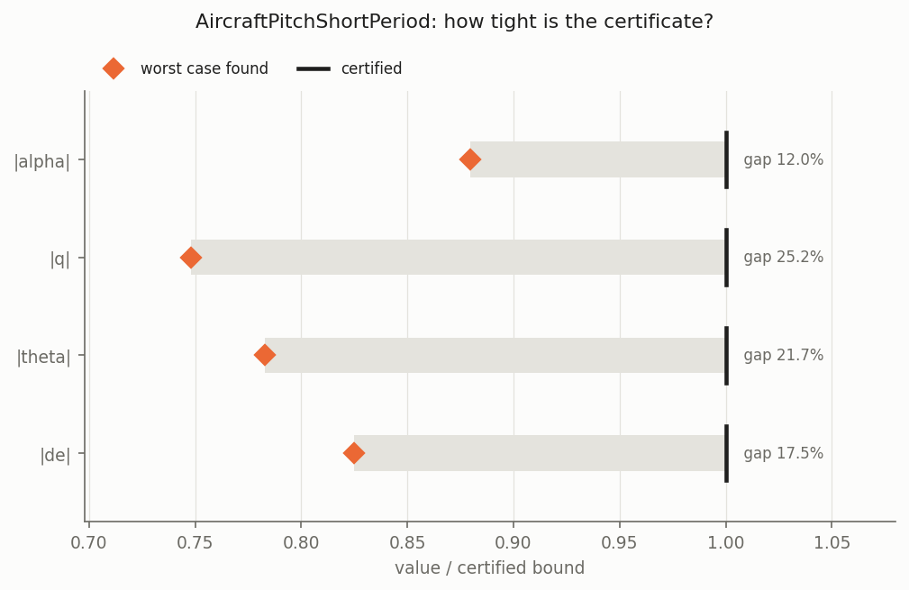
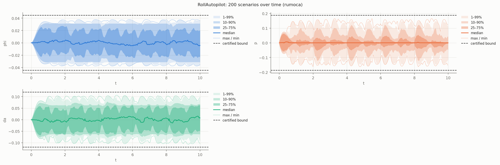
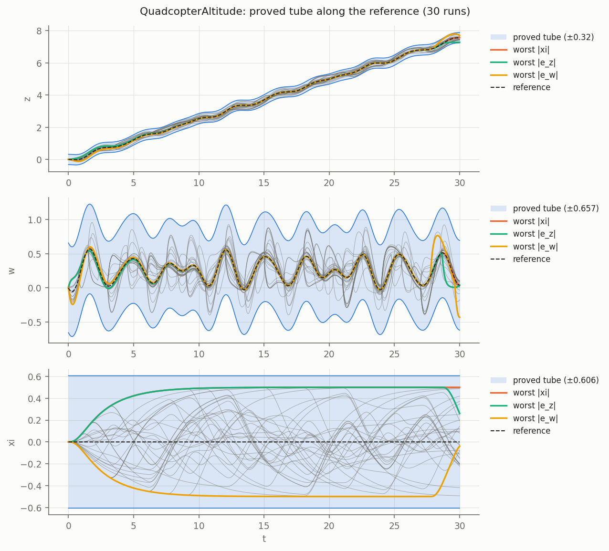
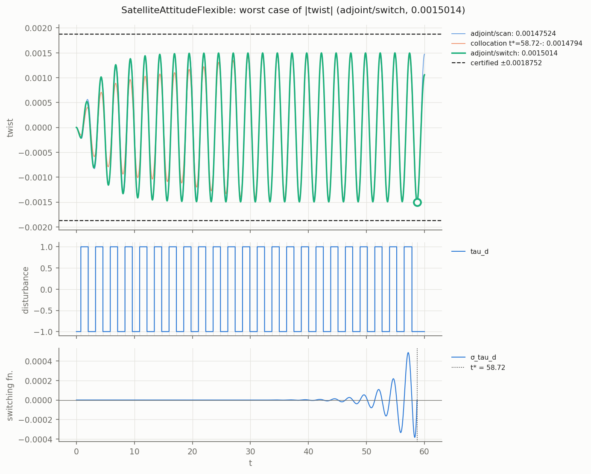

# Aerospace examples

Closed-loop flight-control and spacecraft models written entirely in Modelica. All parameter
values are illustrative, not taken from a specific vehicle.

| Model | What it is | Annotations |
|---|---|---|
| `AircraftPitchShortPeriod` | Short-period pitch dynamics + elevator servo, pitch-attitude hold, vertical gust | 1 disturbance, LTI |
| `RollAutopilot` | Roll dynamics + aileron servo, bank-angle hold, uncertain roll damping L_p | 1 disturbance, 1 uncertain parameter |
| `QuadcopterAltitude` | Vertical quadcopter dynamics tracking an altitude trajectory, thrust feedforward + PID | reference chain, 1 disturbance |
| `PlanarQuadrotor` | Planar quadrotor at hover, cascaded controller (thrust vector + atan2 pitch command), the model of "Where to Tear" | 3 disturbances, nonlinear (`sector`, `compose`) |
| `Quadrotor3D` | Full 3D quadrotor at hover, quaternion chart, cascaded controller with an ideal rate loop | 6 disturbances, polynomial nonlinearity (`compose`, 10 % level; [docs/sector.md](../../docs/sector.md) §7) |
| `SatelliteAttitudeFlexible` | Single-axis hub + flexible solar array (two-inertia), collocated PD | 1 disturbance, LTI |

```
python3 -m dynacert examples/aerospace/<Model>.mo lmi -q
python3 -m dynacert examples/aerospace/<Model>.mo montecarlo --n 200 -q
python3 -m dynacert examples/aerospace/<Model>.mo falsify -q
python3 -m dynacert examples/aerospace/QuadcopterAltitude.mo tube -q
```

## Results

"Certified" is the bound proved by `<Model>.Cert.certified`; "Monte Carlo" the largest peak in
200 random admissible scenarios; "falsify" the worst case found by the adjoint/collocation
search (a lower bound on the true worst case). Ratio = falsify / certified.

### AircraftPitchShortPeriod

Claim: for every gust with |α_g(t)| ≤ 0.03 rad, starting at trim, the angle-of-attack, pitch
rate, pitch attitude and elevator deflection deviations stay within the bounds.

| Output | Certified | Monte Carlo | Falsify | Ratio |
|---|---|---|---|---|
| `alpha` [rad] | 0.03407 | 0.02997 | 0.02997 | 0.880 |
| `q` [rad/s] | 0.04141 | 0.03074 | 0.03097 | 0.748 |
| `theta` [rad] | 0.01303 | 0.01018 | 0.01020 | 0.783 |
| `de` [rad] | 0.03610 | 0.02973 | 0.02977 | 0.825 |

Run time: `lmi` 58 s, `montecarlo` 13 s, `falsify` 18 s.

### RollAutopilot

Claim: for every turbulence rolling acceleration |L_dist(t)| ≤ 0.5 rad/s² and every roll
damping L_p ∈ [-2.5, -0.8] 1/s, the bank angle, roll rate and aileron deflection stay within the
bounds.

| Output | Certified | Monte Carlo | Falsify | Ratio |
|---|---|---|---|---|
| `phi` [rad] | 0.04456 | 0.03802 | 0.03807 | 0.854 |
| `p` [rad/s] | 0.1878 | 0.1652 | 0.1665 | 0.887 |
| `da` [rad] | 0.1193 | 0.1063 | 0.1067 | 0.894 |

Run time: `lmi` 48 s, `montecarlo` 7 s, `falsify` 21 s.

### QuadcopterAltitude

Claim: along every altitude reference with z_ref' = w_ref, w_ref' = a_ref (a_ref arbitrary,
starting at rest) and every disturbance force |F_d(t)| ≤ 2 N, the altitude error, vertical
speed error and PID integrator stay within the bounds. `Cert.tube` carries the same ellipsoid
along the reference.

| Output | Certified | Monte Carlo (T = 30 s) | Falsify (T = 30 s) | Ratio |
|---|---|---|---|---|
| `xi` [m·s] | 0.6065 | 0.5000 | 0.5000 | 0.824 |
| `e_z` [m] | 0.3201 | 0.2875 | 0.2875 | 0.898 |
| `e_w` [m/s] | 0.6570 | 0.4589 | 0.4692 | 0.714 |

Tube (T = 30 s): 30 runs on a random reference reach max zᵀPz/level = 0.963, adjoint worst
cases 0.975; every run stays inside the proved tube.

Run time: `lmi` 928 s (most of it apparently waiting on concurrent `lake` builds from other
jobs; comparable models took 30-60 s), `montecarlo` 8 s, `falsify` 18 s (T = 10) / 55 s
(T = 30), `tube` 72 s (T = 10) / 93 s (T = 30). The gravity term `m*g` cancels against the
feedforward and is handled exactly.

### SatelliteAttitudeFlexible

Claim: for every disturbance torque |τ_d(t)| ≤ 1 N·m, starting at rest, the hub pointing
error, hub rate and array twist stay within the bounds.

| Output | Certified | Monte Carlo (T = 60 s) | Falsify (T = 60 s) | Ratio |
|---|---|---|---|---|
| `th_hub` [rad] | 0.002886 | 0.002500 | 0.002501 | 0.867 |
| `w_hub` [rad/s] | 0.002034 | 0.001197 | 0.001299 | 0.638 |
| `twist` [rad] | 0.001875 | 0.001106 | 0.001501 | 0.801 |

Run time: `lmi` 26 s, `montecarlo` 5 s, `falsify` 13 s (T = 10) / 54 s (T = 60). The
lightly damped array mode (ζ ≈ 0.09) needs a resonant bang-bang torque to reach the worst
twist; random scenarios reach only 0.59 of the bound.

## Figures

### AircraftPitchShortPeriod: falsify tightness (lower bounds vs certified)



### RollAutopilot: Monte Carlo envelope



### QuadcopterAltitude: proved tube along a reference



### SatelliteAttitudeFlexible: worst-case torque for array twist



### PlanarQuadrotor

Claim: starting at hover, for every gust `|w_x|, |w_z| ≤ 0.25 m/s²` and torque
`|w_q| ≤ 1.25 rad/s²` (25 % of the paper's full level), the lateral error and the pitch stay
within the bounds. The model is nonlinear (`sin`, `cos`, `√`, `atan2`); see
[docs/sector.md](../../docs/sector.md).

| Output | `sector` | `compose` (cut B, ADMM) | Monte Carlo (500 runs) | paper (tube / MC) |
|---|---|---|---|---|
| `e_x` [m] | 0.16044 | 0.16047 | 0.0937 | 0.178 / 0.093 |
| `theta` [rad] | 0.14588 | 0.14591 | 0.0766 | 0.164 / 0.076 |

```
python3 -m dynacert examples/aerospace/PlanarQuadrotor.mo certify sector
python3 -m dynacert examples/aerospace/PlanarQuadrotor.mo certify compose
python3 -m dynacert examples/aerospace/PlanarQuadrotor.mo montecarlo --n 500 --T 12
```
