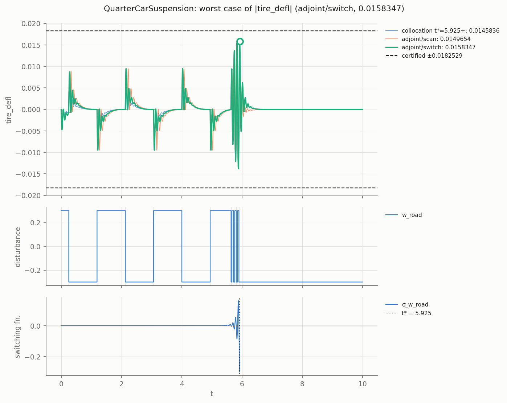
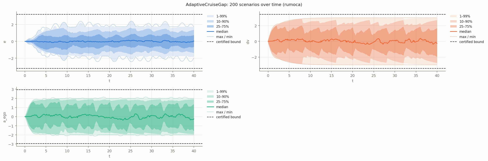
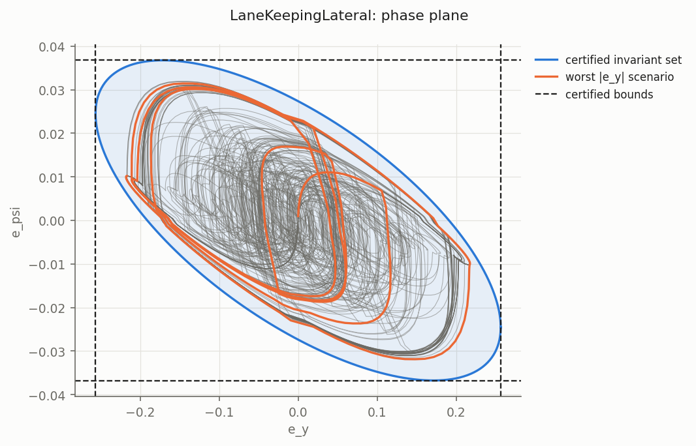

# Automotive examples

Closed-loop vehicle models written entirely in Modelica, with the controller in the model.
All parameter values are illustrative (typical order of magnitude), not taken from a specific
vehicle.

| Model | What it is | Annotations |
|---|---|---|
| `QuarterCarSuspension` | Two-mass quarter car with skyhook active damping, road velocity as disturbance | 1 disturbance, LTI |
| `AdaptiveCruiseGap` | Constant-time-headway ACC with a first-order powertrain lag of uncertain bandwidth | 1 disturbance, 1 uncertain parameter (polytopic) |
| `LaneKeepingLateral` | Linear bicycle model in lane-error coordinates, LQR steering + curvature feedforward | 1 disturbance, LTI |

```
python3 -m dynacert examples/automotive/<Model>.mo            # assessment
python3 -m dynacert examples/automotive/<Model>.mo lmi -q     # certificate (Lean-checked)
python3 -m dynacert examples/automotive/<Model>.mo montecarlo --n 200 -q
python3 -m dynacert examples/automotive/<Model>.mo falsify -q
```

## Results

"Certified" is the bound proved by `<Model>.Cert.certified`. "Monte Carlo" is the largest peak
over 200 random admissible scenarios, "falsify" the worst case found by the adjoint /
collocation search (a lower bound on the true worst case). Ratio = falsify / certified, so a
ratio near 1 means the certificate is tight. Horizon 10 s unless stated.

### QuarterCarSuspension

Claim: for every road profile whose vertical velocity satisfies |w_road(t)| ≤ 0.3 m/s, starting
at rest, the suspension stroke and tire deflection stay within the bounds for all time.

| Output | Certified | Monte Carlo | Falsify | Ratio |
|---|---|---|---|---|
| `susp_defl` [m] | 0.08267 | 0.05682 | 0.05682 | 0.687 |
| `tire_defl` [m] | 0.01825 | 0.00946 | 0.01583 | 0.868 |

Run time: `lmi` 64 s, `montecarlo` 9 s, `falsify` 20 s. The worst tire deflection needs a
bang-bang road velocity at the wheel-hop frequency; random scenarios reach only half of it
(figure `figures/QuarterCarSuspension-worstcase-tire_defl.png`).

### AdaptiveCruiseGap

Claim: for every lead-vehicle acceleration |a_lead(t)| ≤ 2 m/s² and every powertrain
bandwidth w_pt ∈ [2, 5] rad/s, starting at the equilibrium gap, the spacing error, relative
speed and ego acceleration stay within the bounds (common quadratic Lyapunov function over the
two vertices).

| Output | Certified | Monte Carlo (T = 40 s) | Falsify (T = 40 s) | Ratio |
|---|---|---|---|---|
| `e` [m] | 3.203 | 2.420 | 2.421 | 0.756 |
| `dv` [m/s] | 3.433 | 3.000 | 3.000 | 0.874 |
| `a_ego` [m/s²] | 2.951 | 2.130 | 2.157 | 0.731 |

Run time: `lmi` 37 s, `montecarlo` 6 s, `falsify` 21 s (T = 10) / 62 s (T = 40). With the
default 10 s horizon the achieved peaks are 2.30 / 2.94 / 2.13 (the slowest closed-loop pole is
about -0.33 1/s).

Notes: the model is written directly in error coordinates `(e, dv, a_ego)`. Two
formulations that are more natural did not certify:
- absolute states `gap, v_ego, v_lead` with `e = gap - s0 - h*v_ego`: assessment reports
  "coordinates [...] are not closed under the dynamics", although `(e, dv, a_ego)` is closed;
  dynacert only builds an error frame from declared references, and the constant `s0` makes the
  output affine rather than linear;
- `der(a_ego) = w_pt*(a_cmd - a_ego)` with the algebraic `a_cmd`: the LMI search succeeds but
  the generated link proof fails in Lean (`ring failed`), because the algebraic equation is
  not multiplied by the uncertain parameter in `linear_combination`. The model writes the
  control law out inside `der(a_ego)`.

### LaneKeepingLateral

Claim: at 20 m/s, for every road-curvature profile |κ(t)| ≤ 0.005 1/m (radius ≥ 200 m),
starting centred and aligned, the lateral offset and heading error stay within the bounds.

| Output | Certified | Monte Carlo | Falsify | Ratio |
|---|---|---|---|---|
| `e_y` [m] | 0.2564 | 0.2178 | 0.2179 | 0.850 |
| `e_psi` [rad] | 0.03675 | 0.03215 | 0.03229 | 0.878 |

Run time: `lmi` 58 s, `montecarlo` 8 s, `falsify` 13 s.

## Figures

### QuarterCarSuspension: worst-case road input for tire deflection



### AdaptiveCruiseGap: Monte Carlo envelope (40 s)



### LaneKeepingLateral: phase plane with the certified ellipse


