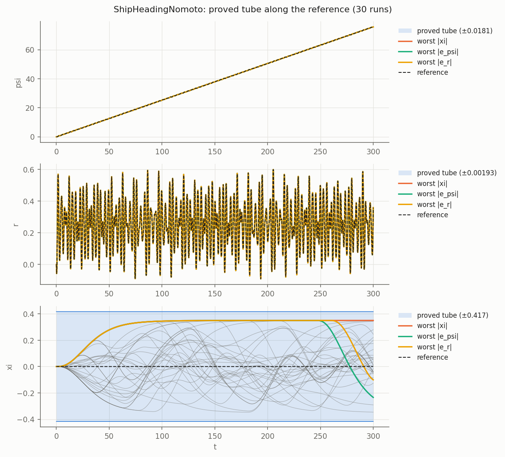
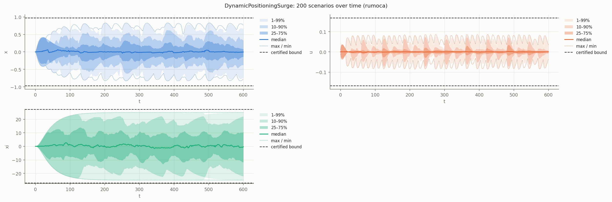
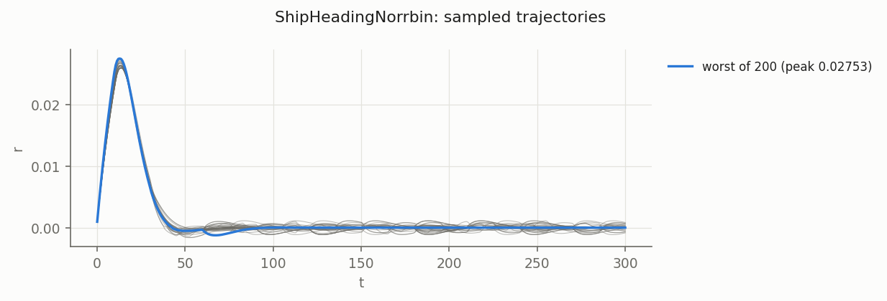

# Marine examples

Ship and offshore-vessel control loops written entirely in Modelica. All parameter values are
illustrative.

| Model | What it is | Annotations |
|---|---|---|
| `ShipHeadingNomoto` | First-order Nomoto ship, PID autopilot with model-inverting feedforward, tracking a course change | reference chain, 1 disturbance |
| `DynamicPositioningSurge` | DP station keeping in surge, PID, uncertain hull damping | 1 disturbance, 1 uncertain parameter |
| `ShipHeadingNorrbin` | Norrbin (cubic yaw damping) ship with rudder saturation, 30° course change | nonlinear, **validation only** |

```
python3 -m dynacert examples/marine/<Model>.mo lmi -q
python3 -m dynacert examples/marine/<Model>.mo montecarlo --n 200 --T 300 -q
python3 -m dynacert examples/marine/<Model>.mo falsify --T 300 -q
python3 -m dynacert examples/marine/ShipHeadingNomoto.mo tube --T 300 -q
```

Ships respond in minutes, so the default 10 s horizon of `montecarlo`/`falsify` is far too
short here: with it, the ratios below drop to 0.04-0.30, which says nothing about tightness.
Results are reported with `--T 300` (ship) and `--T 600` (DP).

## Results

"Certified" is the bound proved by `<Model>.Cert.certified`; "Monte Carlo" the largest peak in
200 random admissible scenarios; "falsify" the worst case found by the adjoint/collocation
search (a lower bound on the true worst case). Ratio = falsify / certified.

### ShipHeadingNomoto

Claim: along every heading reference psi_ref' = r_ref, r_ref' = a_ref (a_ref arbitrary,
starting at rest) and every wave disturbance |d_wave(t)| ≤ 0.035 rad (2° equivalent rudder),
the heading error, yaw-rate error and integrator stay within the bounds. `Cert.tube` carries
the set along the course change.

| Output | Certified | Monte Carlo (T = 300 s) | Falsify (T = 300 s) | Ratio |
|---|---|---|---|---|
| `xi` [rad·s] | 0.4172 | 0.3500 | 0.3500 | 0.839 |
| `e_psi` [rad] | 0.01812 | 0.01630 | 0.01630 | 0.899 |
| `e_r` [rad/s] | 0.001933 | 0.001526 | 0.001536 | 0.795 |

Tube (T = 300 s): 30 runs on a random reference reach max zᵀPz/level = 0.925, adjoint worst
cases 0.937; all inside.

Run time: `lmi` 26 s, `montecarlo` 9 s, `falsify` 474 s (T = 300), `tube` 76 s (T = 300).

### DynamicPositioningSurge

Claim: for every wave-drift/gust force |F_wave(t)| ≤ 100 kN and every linear damping
D ∈ [30, 80] kN·s/m, the position excursion, surge speed and integrator stay within the bounds
(position watch circle).

| Output | Certified | Monte Carlo (T = 600 s) | Falsify (T = 600 s) | Ratio |
|---|---|---|---|---|
| `x` [m] | 0.9692 | 0.8303 | 0.8303 | 0.857 |
| `u` [m/s] | 0.1672 | 0.08578 | 0.08662 | 0.518 |
| `xi` [m·s] | 27.22 | 25.00 | 25.00 | 0.919 |

Run time: `lmi` 29 s, `montecarlo` 6 s, `falsify` 855 s (T = 600). Units are tonnes / kN /
m to keep the LMI well scaled. The integrator peak 25 = F/ki is the steady state under a
constant 100 kN force.

### ShipHeadingNorrbin (validation only)

Not certifiable by `lmi`: the cubic yaw damping `alpha*r^3` and the hard rudder limit
`max(-rmax, min(rmax, ...))` make the dynamics nonlinear (assessment: "der(r) is nonlinear in
psi, r"). `montecarlo` and `falsify` still run. Only the yaw rate is annotated: the heading
error and rudder command peak at t = 0 from the initial 30° error.

| Output | Monte Carlo (300 runs, T = 300 s) | Falsify (T = 300 s) |
|---|---|---|
| `r` [rad/s] | 0.02753 | 0.02753 |

Run time: `montecarlo` 7 s, `falsify` 217 s. The worst case is the turn itself; the 2° wave
disturbance barely changes the peak yaw rate.

A smooth saturation `rmax*tanh(rudder_cmd/rmax)` was tried first: the assessment hangs in
`sympy.solve` (killed after several minutes), so the model uses a hard limit.

## Figures

### ShipHeadingNomoto: proved tube along a course change



### DynamicPositioningSurge: Monte Carlo envelope (600 s)



### ShipHeadingNorrbin: Monte Carlo traces


