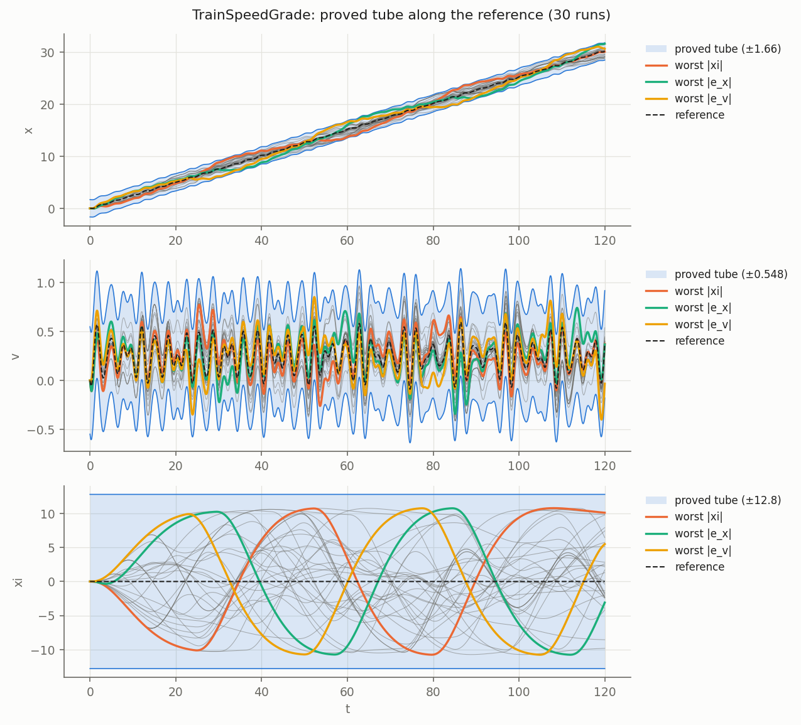
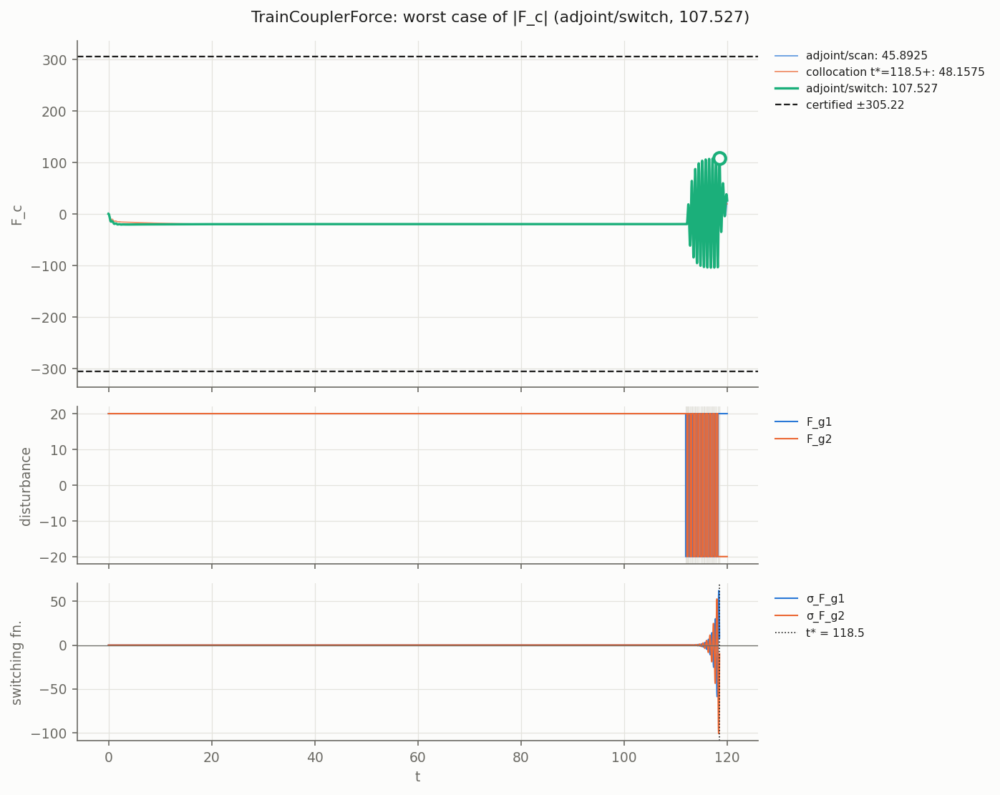
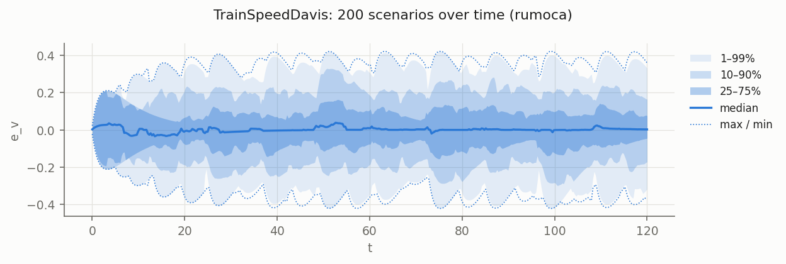

# Rail examples

Train control loops written entirely in Modelica. Units are tonnes, kN and metres. All
parameter values are illustrative.

| Model | What it is | Annotations |
|---|---|---|
| `TrainSpeedGrade` | ATO position/speed tracking of a timetable profile, feedforward + PID, grade force as disturbance | reference chain, 1 disturbance |
| `TrainCouplerForce` | Locomotive + car joined by an elastic coupler, PI speed control, coupler force certified | 2 disturbances, LTI |
| `TrainSpeedDavis` | Cruise control with full quadratic Davis resistance and sin(grade) | nonlinear, **validation only** |

```
python3 -m dynacert examples/rail/<Model>.mo lmi -q
python3 -m dynacert examples/rail/<Model>.mo montecarlo --n 200 --T 120 -q
python3 -m dynacert examples/rail/<Model>.mo falsify --T 120 -q
python3 -m dynacert examples/rail/TrainSpeedGrade.mo tube --T 120 -q
```

The trains respond over tens of seconds, so results are reported with `--T 120`; the default
10 s horizon gives ratios of 0.37-0.58 for `TrainSpeedGrade`.

## Results

"Certified" is the bound proved by `<Model>.Cert.certified`; "Monte Carlo" the largest peak in
200 random admissible scenarios; "falsify" the worst case found by the adjoint/collocation
search (a lower bound on the true worst case). Ratio = falsify / certified.

### TrainSpeedGrade

Claim: along every timetable profile x_ref' = v_ref, v_ref' = a_ref (a_ref arbitrary, starting
at rest) and every grade force |F_grade(t)| ≤ 78.5 kN (2 % grade on 400 t), the position error
(stopping accuracy), speed error and integrator stay within the bounds. `Cert.tube` carries the
set along the profile.

| Output | Certified | Monte Carlo (T = 120 s) | Falsify (T = 120 s) | Ratio |
|---|---|---|---|---|
| `xi` [m·s] | 12.82 | 10.78 | 10.79 | 0.842 |
| `e_x` [m] | 1.659 | 1.461 | 1.474 | 0.888 |
| `e_v` [m/s] | 0.5478 | 0.3962 | 0.4010 | 0.732 |

Tube (T = 120 s): 30 runs on a random reference reach max zᵀPz/level = 0.895, adjoint worst
cases 0.899; all inside.

Run time: `lmi` 27 s, `montecarlo` 7 s, `falsify` 22 s (T = 10) / 213 s (T = 120), `tube`
78 s.

### TrainCouplerForce

Claim: for grade/wind perturbations |F_g1(t)| ≤ 20 kN on the locomotive and |F_g2(t)| ≤ 20 kN
on the car (independent), starting at steady cruise, the locomotive speed deviation, coupler
stretch and coupler force deviation stay within the bounds.

| Output | Certified | Monte Carlo (T = 120 s) | Falsify (T = 120 s) | Ratio |
|---|---|---|---|---|
| `dv_loco` [m/s] | 0.4026 | 0.1704 | 0.1981 | 0.492 |
| `s` [m] | 0.06081 | 0.00967 | 0.02144 | 0.352 |
| `F_c` [kN] | 305.2 | 48.48 | 107.5 | 0.352 |

Run time: `lmi` 42 s, `montecarlo` 10 s, `falsify` 18 s (T = 10) / 114 s (T = 120). This is
the loosest certificate in this set: with two independent disturbance channels the
per-channel quadratic bound adds the channels' contributions, and the coupler mode (about
1.9 Hz) and the slow speed loop (pole near -0.10 1/s) are very different time scales for a
single ellipsoid. Random scenarios reach only 16 % of the coupler-force bound; the adjoint
worst case reaches 35 %.

### TrainSpeedDavis (validation only)

Not certifiable by `lmi`: the aerodynamic term `A2*v^2` and `sin(grade0 + d_grade)` make the
dynamics nonlinear (assessment: "der(v) is nonlinear in d_grade, v").

| Output | Monte Carlo (300 runs, T = 120 s) | Falsify (T = 120 s) |
|---|---|---|
| `e_v` [m/s] | 0.4213 | 0.4213 |

Run time: `montecarlo` 8 s, `falsify` 82 s (T = 120).

## Figures

### TrainSpeedGrade: proved tube along a timetable profile



### TrainCouplerForce: worst-case perturbations for coupler force



### TrainSpeedDavis: Monte Carlo envelope


